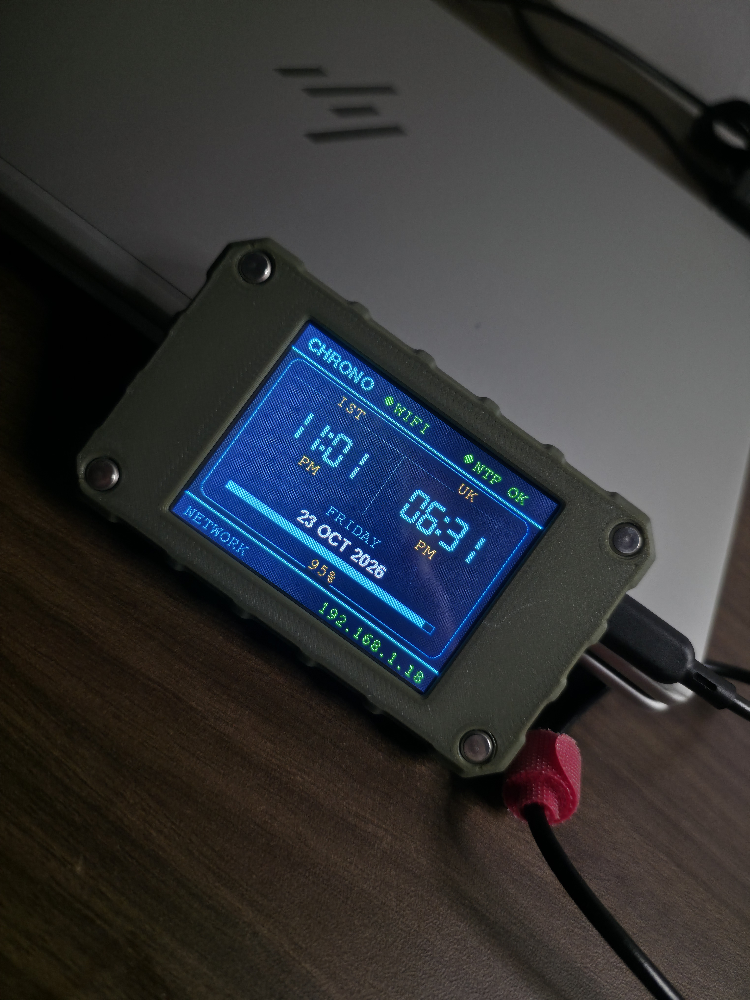

# Digital Clock — CrowPanel ESP32 HMI 2.8-inch

A Wi-Fi-connected digital clock for the Elecrow 2.8-inch ESP32 HMI display. The CHRONO interface shows Indian Standard Time (IST), UK local time (including UK daylight-saving changes), the date, and a daily progress bar. It connects to Wi-Fi, synchronizes UTC time using NTP, retries connections with backoff, and can keep displaying cached system time after a temporary network outage.

## Project layout

- `platformio/` — primary and maintained firmware project. Open this folder in VS Code with PlatformIO.
- `arduino/Digital_Clock/` — Arduino IDE sketch and the matching display setup. Its clock UI and firmware behavior are kept in sync with `platformio/src/main.cpp`.

The PlatformIO source is the reference implementation. When updating the UI or firmware, update the Arduino sketch to match; do not make unrelated changes to the PlatformIO source.

## Hardware and software

- Elecrow CrowPanel ESP32 HMI, 2.8-inch, 240 × 320 ILI9341 display
- USB data cable and a 2.4 GHz Wi-Fi network
- Visual Studio Code with the PlatformIO IDE extension
- PlatformIO project configuration pins ESP32 platform 5.3.0, Arduino framework, TFT_eSPI 2.5.0, and Time library 1.6.x

## Configure Wi-Fi

Before building, create a private credentials file from the example in the firmware environment you intend to build:

- PlatformIO: copy `platformio/include/secrets.example.h` to `platformio/include/secrets.h`.
- Arduino IDE: copy `arduino/Digital_Clock/secrets.example.h` to `arduino/Digital_Clock/secrets.h`.

Edit the copied file and set `WIFI_SSID` and `WIFI_PASSWORD` to your network credentials. Keep `secrets.h` private and do not commit it. The checked-in example files contain placeholders only.

## Start with PlatformIO in VS Code

1. Install Visual Studio Code and the **PlatformIO IDE** extension.
2. In VS Code, choose **File → Open Folder…** and open this project's `platformio` folder (the folder containing `platformio.ini`). Do not open the repository root as the PlatformIO project.
3. Create and edit `include/secrets.h` as described above.
4. Connect the CrowPanel by USB. If the serial port is not detected, install the USB-to-serial driver appropriate for your board and select the correct port in PlatformIO.
5. Wait for PlatformIO to install the configured ESP32 platform and libraries.
6. Use the PlatformIO toolbar or its project tasks to **Build**. Then select the board's serial port and **Upload** the firmware.
7. Open **PlatformIO: Monitor** (or run the Monitor task) at **115200 baud** to view startup, Wi-Fi, and NTP status messages. Reset the display after upload if it does not restart automatically.

The checked-in `platformio.ini` defines the board, dependencies, display pinout, and upload/monitor speeds. Leave it unchanged unless intentionally changing the hardware/toolchain configuration.

## Use and customize

On startup the clock attempts to join the configured Wi-Fi network, then requests time from `time.google.com`, `pool.ntp.org`, and `time.cloudflare.com`. The display shows IST and UK time, 12/24-hour format, the date, Wi-Fi/NTP status, the local IP address, and the fraction of the IST day elapsed. NTP is resynchronized periodically; if Wi-Fi is lost, reconnection attempts use an increasing delay.

To customize common behavior, edit the matching setting in both firmware sources (`platformio/src/main.cpp` and `arduino/Digital_Clock/Digital_Clock.ino`):

- `USE_12H_FORMAT`: use `1` for 12-hour or `0` for 24-hour display.
- `CLOCK_SHOW_SECONDS`: enable or disable the seconds segments (`1` or `0`).
- `NTP_SERVERS`: change or reorder the NTP server hostnames.
- `IST_OFFSET_SECONDS`: IST offset from UTC in seconds; UK time uses the UK timezone/DST rule in `getZonedTimes()`.
- UI labels, drawing functions, and color constants: adjust the CHRONO layout and appearance while preserving the 320 × 240 landscape coordinates and display configuration.
- Wi-Fi retry and NTP timeout/resync constants: tune network behavior if required.

`arduino/Digital_Clock/User_Setup.h` records the TFT_eSPI display configuration for Arduino IDE builds. Keep it consistent with the `build_flags` in `platformio/platformio.ini` if hardware settings are ever intentionally changed.

## Arduino IDE (alternative)

Open `arduino/Digital_Clock/Digital_Clock.ino` in Arduino IDE, install the ESP32 Arduino board package and the same TFT_eSPI version/configuration used by the project, create `secrets.h` beside the sketch, select the ESP32 board/port, then build and upload. PlatformIO is the recommended build path because its configuration pins the project's dependencies and display flags.
