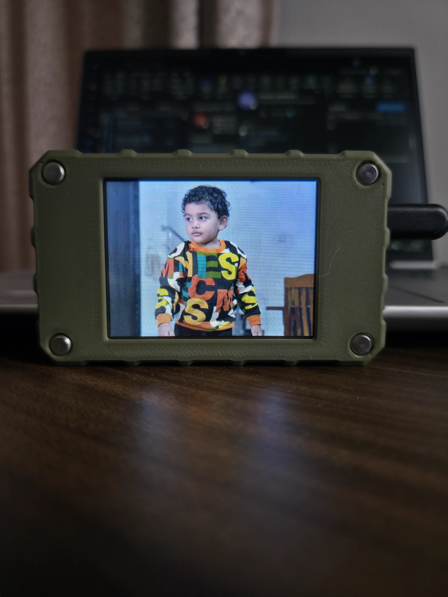
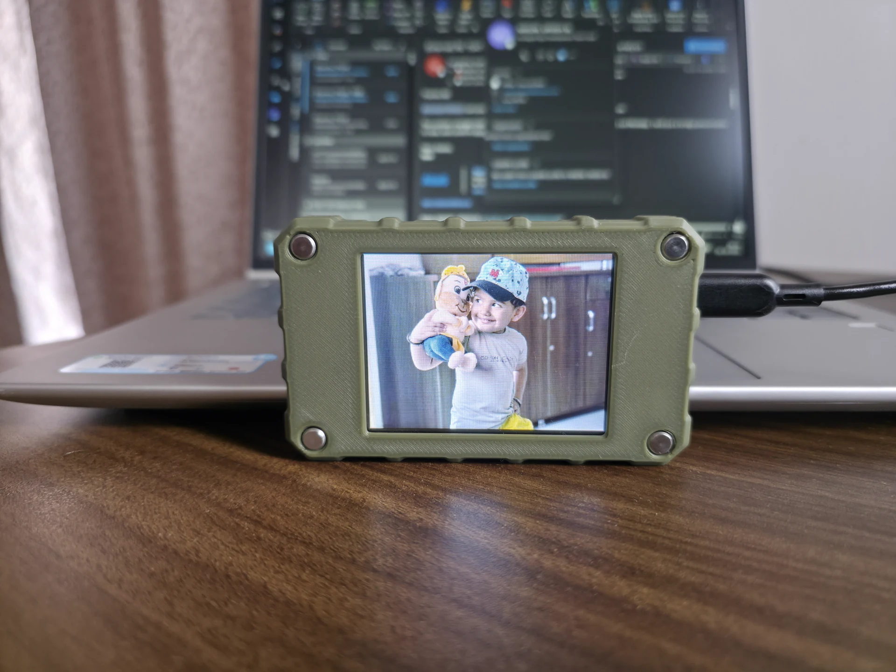
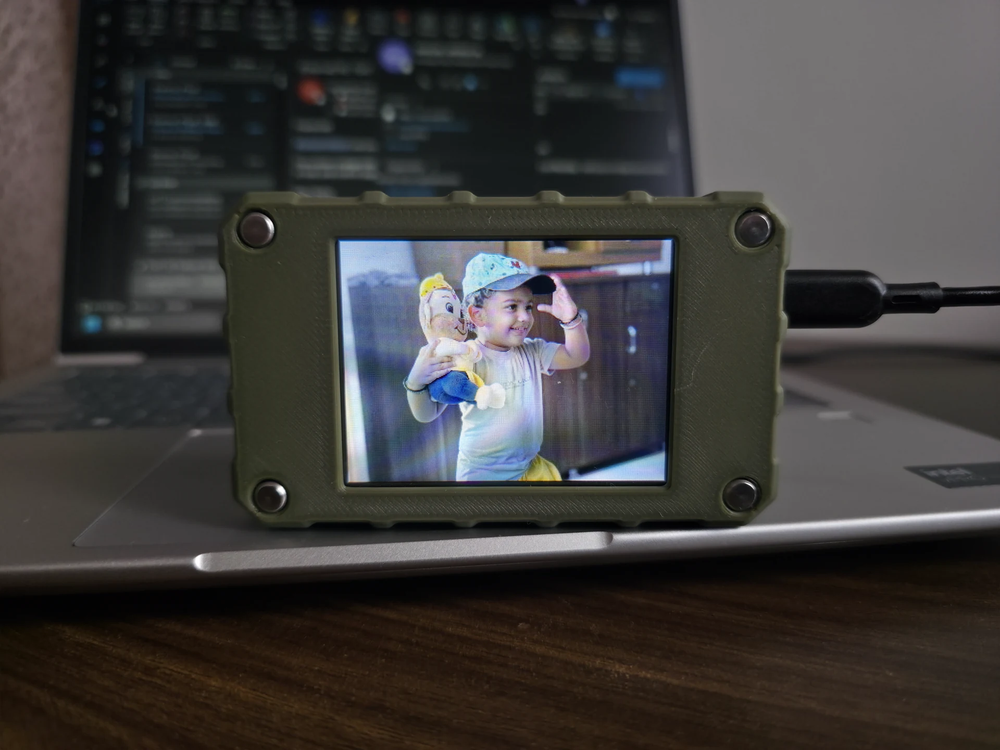
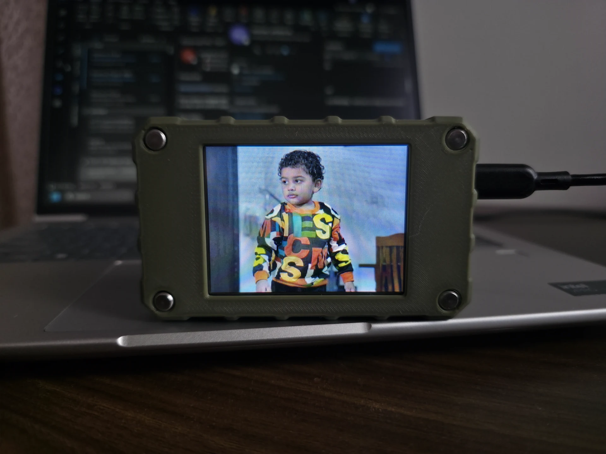
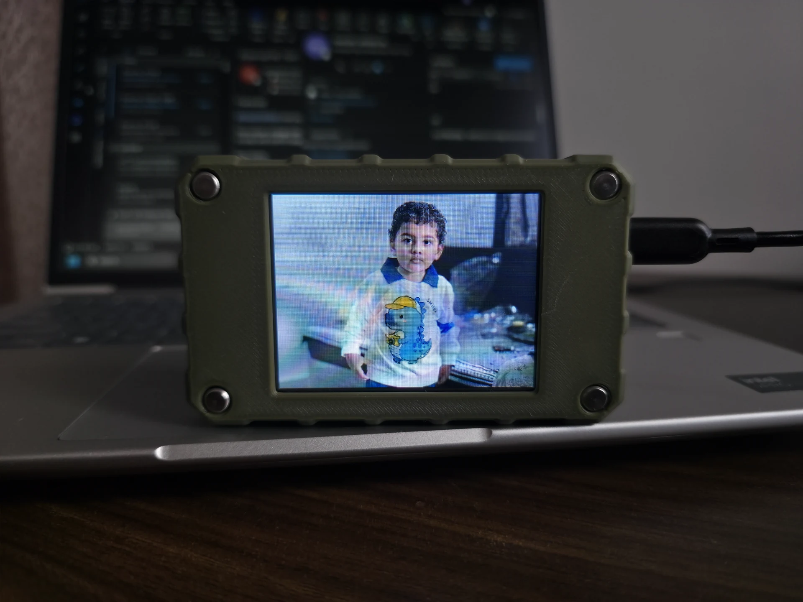
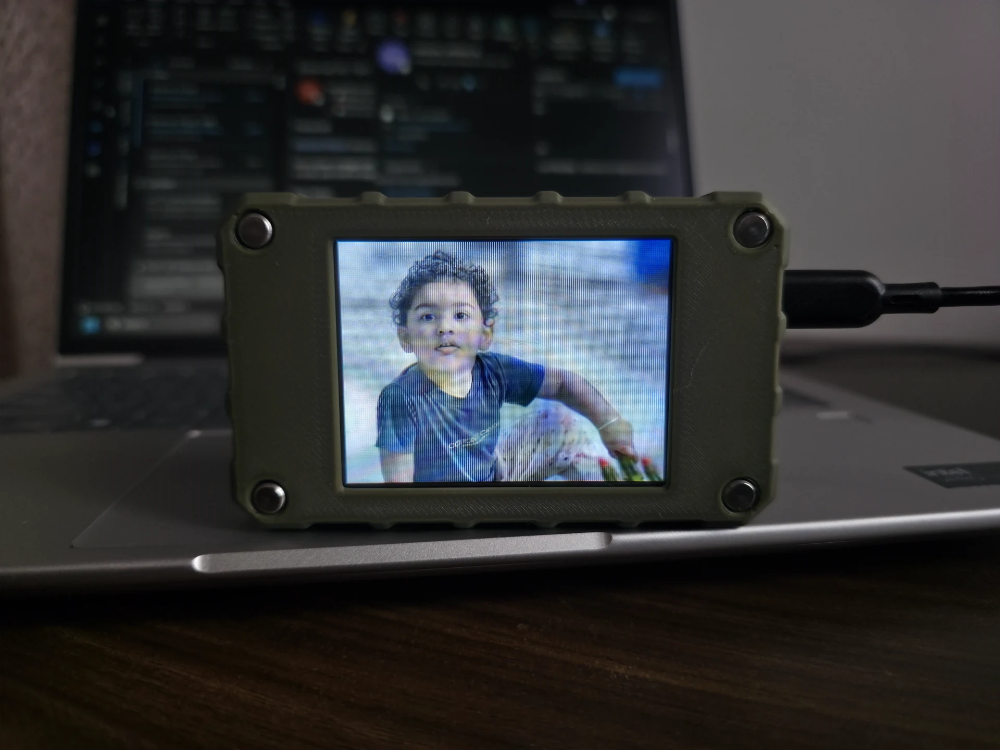

# ESP32 Digital Photo Frame — Elecrow 2.8" ESP32 LCD Display

An end-to-end, high-performance Digital Photo Frame running on the **Elecrow 2.8" ESP32 Solo Miner LCD Display (CrowPanel 2.8")**. Features a responsive web dashboard with drag-and-drop multi-file upload, full-screen slideshow on the 320×240 IPS LCD, multiple transition styles, aspect-ratio scaling modes, live remote controls, and captive portal WiFi provisioning.

---

## Photo Gallery

Sample photos for the 2.8-inch Digital Photo Frame are in [`Photos/`](Photos/). They are shown below as an at-a-glance gallery; click any image to open the full-size file.

| | | |
|:---:|:---:|:---:|
| [](Photos/20261026_140444.webp) | [](Photos/20261026_140455.webp) | [](Photos/20261026_140514.webp) |
| [](Photos/20261026_140518.webp) | [](Photos/20261026_140524.webp) | [](Photos/20261026_140539.webp) |

The original HEIC files are preserved alongside WebP versions for easy viewing in GitHub and use with the photo-frame firmware.

---

## Hardware Overview

| Component | Specification |
|-----------|--------------|
| **Board** | Elecrow 2.8" ESP32 Solo Miner LCD Display (CrowPanel / CYD variant) |
| **Microcontroller** | ESP32-WROOM-32 (Dual-Core 240 MHz, 520 KB SRAM, 4 MB Flash) |
| **Display** | 2.8" 320×240 ILI9341V TFT LCD (Landscape, Rotation 1) |
| **Storage** | Built-in microSD Card Slot (FAT32, dedicated VSPI bus) |
| **Network** | 2.4 GHz 802.11 b/g/n Wi-Fi (Station mode + SoftAP Captive Portal) |

**Display product page:** [Elecrow 2.8-inch ESP32 Miner LCD Display](https://www.elecrow.com/2-8inch-esp32-miner-lcd-display-2pcs-cryptocurrency-solo-miner-with-1000kh-s-hashrate.html)  
**Product wiki:** [2-Pack 2.8-inch ESP32 Solo Miner LCD Display](https://www.elecrow.com/pub/wiki/2-PACK-2.8inch-ESP32-Solo-Miner-LCD-Display-Cryptocurrency-Solo-Miner.html)

### Complete Pin Mapping (Verified Hardware Baseline)

The display and microSD card slot use **two completely independent hardware SPI buses**, eliminating bus contention and chip select collisions:

| Function | GPIO | Hardware Bus | Notes |
|----------|:----:|:------------:|-------|
| **SD MOSI** | `23` | VSPI (SPI3) | MicroSD card data in |
| **SD MISO** | `19` | VSPI (SPI3) | MicroSD card data out |
| **SD SCK** | `18` | VSPI (SPI3) | MicroSD clock (4 MHz stable) |
| **SD CS** | `5` | VSPI (SPI3) | MicroSD chip select |
| **TFT MOSI** | `13` | HSPI (SPI2) | Display data in |
| **TFT SCLK** | `14` | HSPI (SPI2) | Display clock (20 MHz) |
| **TFT CS** | `15` | HSPI (SPI2) | Display chip select |
| **TFT DC** | `2` | HSPI (SPI2) | Display Data / Command control |
| **TFT RST** | `-1` | — | Hardware reset tied to 3.3V |
| **TFT BL** | `27` | — | Backlight control (Active HIGH) |
| **TFT MISO** | `12` | HSPI (SPI2) | Display SPI read |
| **TOUCH CS** | `33` | HSPI (SPI2) | Touch controller chip select |
| **Speaker DAC**| `26` | — | DAC audio output |
| **LED / IO** | `25` | — | Status LED |

> **Key Architecture Note on `USE_HSPI_PORT`:**  
> TFT_eSPI is compiled with `-DUSE_HSPI_PORT` so it instantiates its own `SPIClass` on HSPI (SPI2). The built-in SD card library uses the global `SPI` object on VSPI (SPI3). Both peripherals operate simultaneously in harmony without hardware resource conflicts.

---

## Key Features

1. **Photo Upload via Web Browser**
   - Modern, dark-mode, mobile-friendly web dashboard accessible directly from the device's IP.
   - **Drag-and-Drop + Multi-File Upload Queue**: select multiple JPEG, PNG, or BMP files at once.
   - **Chunked Streaming to SD**: Files stream directly from HTTP packets into the SD card (`/photos/`), avoiding full-RAM buffering and OOM crashes.
   - Real-time progress bar with live transfer speed (KB/s).

2. **Photo Management & Thumbnail Gallery**
   - Live photo grid showing all stored images with dimensions/file size.
   - Gallery thumbnails are generated during upload, stored on the SD card, and loaded on demand to keep gallery browsing responsive.
   - **"Display on Screen"** button: instantly jump the physical display to any photo.
   - Individual photo deletion and single-click **"Delete All"** with confirmation dialog.

3. **High-Performance Slideshow Engine**
   - Decodes **JPEG**, **PNG**, and **BMP** directly from the SD card.
   - **Image Fit Modes**:
     - Auto (Default): Smart adaptive fit — automatically uses **Letterbox** for vertical/portrait photos (prevents cutting off heads or bodies) and **Fullscreen Crop & Fill** for horizontal/landscape photos (fills 320x240 with no black bars).
     - Letterbox Always: Keeps aspect ratio, scales image to fit within 320x240, centers with black bars.
     - Crop & Fill Always: Fills the entire 320x240 screen without black bars, cropping excess edges.
   - **Visual Transition Effects**: Instant, Wipe (Left-to-Right), Vertical Blinds, Curtain Open, and 2-Pass Fade.
   - **Play Order**: Sequential (alphabetical loop) or Shuffle / Random (avoids immediate repeats).
   - **Configurable Slide Duration**: 3s, 5s, 10s, 15s, 30s, 1m, 5m (persisted in NVS).
   - **Graceful Error Recovery**: Automatically detects and skips corrupted images without hanging the frame.

4. **Remote Control from Phone or PC**
   - Play / Pause slideshow toggle.
   - Next Photo and Previous Photo buttons.
   - Force re-render button.

5. **Robust Non-Blocking & Thread-Safe Architecture**
   - `sdMutex` FreeRTOS mutex synchronizes SD card access across the async network task and slideshow rendering engine.
   - When an upload is active, slideshow transitions are cleanly paused to maximize SD write throughput and avoid SPI collisions.

6. **WiFi & Fallback Setup Portal**
   - Automatically attempts connection to configured WiFi in Station mode.
   - If WiFi credentials are unset or the network is unavailable, starts SoftAP (`PhotoFrame-Setup`) with a captive portal (`http://192.168.4.1`).
   - WiFi credentials stored securely in NVS Preferences.

---

## Repository Structure

```
Digital_Photo_Frame/
├── ArduinoIDE/
│   ├── PhotoFrame.ino         # Main Arduino sketch
│   ├── config.h               # Pinout definitions and system parameters
│   ├── image_decoder.h        # JPEG, PNG, and BMP decoding engine
│   ├── index_html.h           # Web dashboard stored in PROGMEM flash
│   └── secrets.h.example      # Optional default WiFi credentials template
├── PlatformIO/
│   ├── platformio.ini         # PlatformIO build configuration with TFT_eSPI flags
│   ├── include/
│   │   ├── config.h           # Pinout and constants
│   │   ├── image_decoder.h    # Image decoders & transitions
│   │   ├── index_html.h       # PROGMEM Web UI
│   │   └── secrets.h.example  # Optional WiFi defaults
│   └── src/
│       └── main.cpp           # Main application entry point
├── www/
│   └── index.html             # Source HTML/CSS/JS web dashboard
├── data/
│   └── index.html             # Mirrored web assets
├── .gitignore
└── README.md                  # Project documentation
```

---

## Library Dependencies

| Library | Exact Version | Purpose |
|---------|:-------------:|---------|
| **bodmer/TFT_eSPI** | `^2.5.43` | High-speed display driver for ILI9341V |
| **bodmer/TJpg_Decoder** | `^1.1.0` | Tiny JPEG decoder integrated with TFT_eSPI |
| **kikuchan98/pngle** | `^1.1.0` | Stream-based portable PNG decoder |
| **me-no-dev/ESPAsyncWebServer** | `^1.2.3` | Asynchronous web server |
| **me-no-dev/AsyncTCP** | `^1.1.1` | Asynchronous TCP stack |
| **ESP32 Arduino Core** | `>= 2.0.14` | Built-in `WiFi`, `SD`, `SPI`, `Preferences`, `DNSServer`, `ArduinoOTA` |

---

## Build and Flash Instructions

**Development and testing:** This project was tested in Visual Studio Code using the PlatformIO extension and build workflow.

### Option 1: PlatformIO (Recommended)

1. Open a terminal in the `PlatformIO/` directory:
   ```bash
   cd "Project/Digital_Photo_Frame/PlatformIO"
   ```
2. *(Optional)* If you want to hardcode your home Wi-Fi credentials for first boot:
   ```bash
   cp include/secrets.h.example include/secrets.h
   # Edit DEFAULT_SSID and DEFAULT_PASS in include/secrets.h
   ```
3. Build the project:
   ```bash
   pio run
   ```
4. Connect the Elecrow 2.8" board via USB-C and flash:
   ```bash
   pio run -t upload
   ```
5. Open Serial Monitor at 115200 baud:
   ```bash
   pio device monitor -b 115200
   ```

### Option 2: Arduino IDE

1. Open Arduino IDE (v2.x recommended).
2. Install the **esp32** board package:
   - Go to **Tools > Board > Boards Manager...**
   - Search for `esp32` by **Espressif Systems** and install version `2.0.14`.
3. Select board: **Tools > Board > ESP32 Arduino > ESP32 Dev Module**.
4. Install required libraries via **Sketch > Include Library > Manage Libraries...**:
   - `TFT_eSPI` by Bodmer
   - `TJpg_Decoder` by Bodmer
   - `pngle` by kikuchan98
   - `ESPAsyncWebServer` by me-no-dev
   - `AsyncTCP` by me-no-dev
5. **Configure `TFT_eSPI` for this hardware:**
   - Locate your Arduino libraries folder (e.g. `Documents/Arduino/libraries/TFT_eSPI/User_Setup.h`).
   - Open `User_Setup.h` and ensure these defines are active:
     ```cpp
     #define ILI9341_DRIVER
     #define TFT_WIDTH  240
     #define TFT_HEIGHT 320
     #define TFT_MISO   12
     #define TFT_MOSI   13
     #define TFT_SCLK   14
     #define TFT_CS     15
     #define TFT_DC     2
     #define TFT_RST    -1
     #define TFT_BL     27
     #define TOUCH_CS   33
     #define USE_HSPI_PORT
     #define SPI_FREQUENCY 20000000
     #define LOAD_GLCD
     #define LOAD_FONT2
     ```
6. Open `ArduinoIDE/PhotoFrame.ino`.
7. Click **Upload** and enjoy!

---

## Additional Hardware Option: CrowPanel 7-inch

The original 2.8-inch PlatformIO target and Arduino IDE configuration above remain unchanged. A separate **display bring-up target** is available for the CrowPanel DIS08070H 7-inch 800×480 RGB model:

- Source: `PlatformIO/7inch/src/main.cpp`
- Build from `PlatformIO/7inch/` with `pio run`.
- Flash with `pio run -t upload` from that directory.
- It initializes the RGB panel using the CrowPanel 7-inch pin/timing example and turns on the backlight (GPIO 2).

**Scope:** this is currently a display initialization/demo target only; it does not include the photo-frame web server, SD photo slideshow, or capacitive-touch integration. Do not select it as a replacement for the 2.8-inch full application. The 7-inch app port needs a display abstraction and separate testing on the DIS08070H hardware.

---

## First-Boot WiFi Setup

1. **Insert a FAT32 MicroSD card** into the board's slot before booting.
2. Power the board via USB-C.
3. If no Wi-Fi credentials are saved:
   - The screen will display:
     ```
     WIFI SETUP REQUIRED
     1. Connect to WiFi Access Point:
        PhotoFrame-Setup
     2. Open Browser & Configure Home WiFi:
        http://192.168.4.1
     ```
4. Connect your smartphone, laptop, or tablet to the **`PhotoFrame-Setup`** network (no password required).
5. Open your browser and navigate to `http://192.168.4.1` (or tap the captive portal notification).
6. Click **WiFi Setup**, select or enter your home WiFi SSID and Password, then click **Save & Connect**.
7. The photo frame saves the credentials to NVS and reboots into your home network.
8. The screen will display its assigned IP address: `http://192.168.X.X`.

---

## How to Upload and Manage Photos

1. Open your web browser on any device on the same home network and go to `http://<Device_IP>` (e.g. `http://192.168.1.150`).
2. **Uploading Photos:**
   - Drag and drop photo files into the upload box, or click to open the file browser.
   - You can upload multiple files simultaneously.
   - The files stream directly to the microSD card in `/photos/`.
   - As soon as the upload completes, the new photo is immediately added to the slideshow!
3. **Controlling the Slideshow:**
   - Use the **Prev**, **Pause/Play**, and **Next** buttons on the web UI to control playback.
   - Adjust **Slide Duration**, **Play Order** (Sequential vs Shuffle), **Fit Mode** (Letterbox vs Crop/Fill), and **Transition Effect** from the sidebar. All settings persist across reboots.
4. **Deleting Photos:**
   - In the **Photo Library** grid, each card has a trash icon to delete individual photos.
   - Click **Delete All** to clear the playlist and card storage.

---

## Supported Image Formats & Size Limits

| Format | File Extensions | Notes |
|:------:|:---------------:|-------|
| **JPEG** | `.jpg`, `.jpeg` | Baseline JPEG supported. Includes hardware-friendly 1/2, 1/4, 1/8 downscaling. *Note: Progressive JPEGs (e.g. from WhatsApp) are automatically converted into 100% compatible Baseline JPEGs on upload via the Web Dashboard.* |
| **PNG** | `.png` | Standard 24-bit/32-bit RGB/RGBA PNGs decoded via stream-based chunks. (For fastest performance, 320×240 or 640×480 is recommended). |
| **BMP** | `.bmp` | 24-bit, 32-bit, and 16-bit uncompressed Windows Bitmaps streamed scanline-by-scanline. |
| **WebP** | `.webp` | Automatically normalized and converted into Baseline JPEG on upload via Web Dashboard. |

---

## Technical Architecture & Memory Footprint

- **RAM Usage:** ~53 KB used out of 328 KB (~275 KB free heap), leaving ample headroom for HTTP upload transfers and WiFi networking.
- **Flash Usage:** ~1.01 MB out of 1.31 MB (77.1%).
- **OTA Updates:** Wireless updates supported via ArduinoOTA on port 3232.

