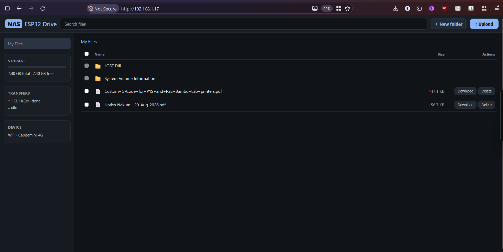

# ESP32 NAS with LCD - Elecrow CrowPanel 2.8"

A network-attached storage (NAS) file server running on the **Elecrow 2.8" ESP32 Solo Miner LCD Display** board (Cheap Yellow Display variant), using the built-in microSD card slot and TFT display for status monitoring.

Ported from [akashdip2001/NAS-with-ESP32](https://github.com/akashdip2001/NAS-with-ESP32).

## Screenshots

| Tech status screen (LCD) | ESP32 Drive — web cloud UI |
|:---:|:---:|
|  |  |

## Features

- **Web-based file server** — browse, download, upload, and **delete** files via browser
- **WiFi configuration portal** — set WiFi credentials through captive web UI
- **TFT status screen** — real-time display of IP, SD capacity/free space, WiFi mode
- **SD error recovery** — auto-retry on mount failure with visual warning screen
- **AP fallback mode** — automatically starts SoftAP if configured WiFi is unavailable
- **WiFi auto-reconnect** — reconnects on drop; falls back to AP after 10 non-blocking attempts
- **Non-blocking WiFi** — initial connection timeout (60s) without blocking display updates
- **OTA updates** — wireless firmware updates via ArduinoOTA
- **NVS credential storage** — WiFi settings persist across reboots via Preferences
- **Path traversal protection** — all file paths validated against `..` sequences
- **secrets.h support** — optional default WiFi credentials (gitignored)

## Project Structure

```
ESP32_NAS/
├── ArduinoIDE/
│   ├── NAS_LCD.ino          # Single-file sketch for Arduino IDE
│   └── secrets.h.example     # Template for default WiFi creds (copy to secrets.h)
├── PlatformIO/
│   ├── platformio.ini        # Build configuration (TFT_eSPI via build_flags)
│   ├── include/
│   │   ├── config.h          # Pin definitions & constants
│   │   ├── secrets.h         # Default WiFi creds (gitignored, optional)
│   │   └── secrets.h.example # Template for secrets.h
│   └── src/
│       └── main.cpp          # Main source (identical logic to .ino)
├── index.html                # Sample drag-drop file browser web UI
└── README.md
```

## Hardware

| Component | Specification |
|-----------|--------------|
| Board | Elecrow 2.8" ESP32 Solo Miner LCD Display (CrowPanel) |
| MCU | ESP32-WROOM-32 |
| Display | 320×240 ILI9341V TFT (landscape, rotation 1) |
| SD Slot | Built-in microSD (SPI bus) |

### Pin Mapping (verified from factory source)

| Function | GPIO | SPI Bus | Notes |
|----------|------|---------|-------|
| SD MOSI | 23 | VSPI (SPI3) | SD card bus |
| SD MISO | 19 | VSPI (SPI3) | SD card bus |
| SD SCK | 18 | VSPI (SPI3) | SD card bus |
| SD CS | 5 | VSPI (SPI3) | SD chip select |
| TFT MOSI | 13 | HSPI (SPI2) | Display bus |
| TFT SCLK | 14 | HSPI (SPI2) | Display bus |
| TFT CS | 15 | HSPI (SPI2) | Display chip select |
| TFT DC | 2 | HSPI (SPI2) | Data/command |
| TFT RST | -1 | — | Reset tied to 3.3V (no GPIO) |
| TFT BL | 27 | — | Backlight (active HIGH) |
| TFT MISO | 12 | HSPI (SPI2) | Display read (unused for writes) |
| TOUCH CS | 33 | HSPI (SPI2) | Touch controller CS |
| Speaker DAC | 26 | — | Not used in this project |
| LED/IO | 25 | — | Not used in this project |

> **Key: TFT and SD use separate SPI buses.** The TFT display runs on **HSPI (SPI2)** via `USE_HSPI_PORT`, and the SD card runs on **VSPI (SPI3)**. The two buses use completely different GPIO pins, so they can operate simultaneously without CS conflicts.

### How `USE_HSPI_PORT` Works

The `USE_HSPI_PORT` flag is a TFT_eSPI preprocessor define that controls which ESP32 SPI bus the library uses internally:

```cpp
// In TFT_eSPI source (TFT_eSPI_ESP32.c):
#ifdef USE_HSPI_PORT
  SPIClass spi = SPIClass(HSPI);    // HSPI = SPI2: MOSI=13, SCLK=14, CS=15, ...
#else
  SPIClass spi = SPIClass(VSPI);    // VSPI = SPI3: MOSI=23, SCLK=18, CS=5, ...
#endif
```

TFT_eSPI creates its **own** `SPIClass` instance — it does not touch the global `SPI` object. This means:
- **With `USE_HSPI_PORT`**: TFT uses HSPI (SPI2), global `SPI` (VSPI/SPI3) stays free for SD card
- **Without `USE_HSPI_PORT`**: TFT uses VSPI — same bus as SD card, causing SPI conflicts

### SD Card

The SD card uses the ESP32's default VSPI bus (SPI3) on pins 23/19/18/5.

## Library Dependencies

| Library | Version | Purpose |
|---------|---------|---------|
| **TFT_eSPI** (Bodmer) | ≥ 2.5.43 | Display driver for ILI9341V |
| **ESPAsyncWebServer** (me-no-dev) | ≥ 1.2.3 | Async HTTP server |
| **AsyncTCP** (me-no-dev) | ≥ 1.1.1 | TCP layer for ESPAsyncWebServer |
| ESP32 core libraries | Built-in | WiFi, SD, SPI, Preferences |

> **Why TFT_eSPI instead of LVGL?** The Elecrow factory code uses TFT_eSPI directly. For a status dashboard with text and simple graphics, TFT_eSPI is lighter, has fewer dependencies, and avoids the complexity of LVGL's build system. LVGL can be added later if richer widgets are needed.

## Build Instructions

### PlatformIO (Recommended)

1. Install [PlatformIO Core](https://platformio.org/install/cli) or use the VS Code extension
2. Navigate to the `PlatformIO/` directory:
   ```bash
   cd "CrowPanel - ESP32 HMI Display - 2.8 Inch/Project/ESP32_NAS/PlatformIO"
   ```
3. Build:
   ```bash
   pio run
   ```
4. Upload to board:
   ```bash
   pio run --target upload
   ```
5. Monitor serial output:
   ```bash
   pio device monitor
   ```

All TFT_eSPI pin configuration is handled via `build_flags` in `platformio.ini` — no manual `User_Setup.h` editing needed.

> **Note:** `lib_ldf_mode = deep` is set in `platformio.ini`. This is required because the `ESP Async WebServer` library has spaces in its name, which causes PlatformIO's default LDF scanner to fail on Windows.

### Arduino IDE

1. Install Arduino IDE and add ESP32 board support:
   - File → Preferences → Additional Boards Manager URLs:
     `https://raw.githubusercontent.com/espressif/arduino-esp32/gh-pages/package_esp32_index.json`
   - Tools → Board → Manager → search "esp32" → install **Espressif Systems ESP32** (v2.x)

2. Install required libraries via **Sketch → Include Library → Manage Libraries**:
   - Search `TFT_eSPI` → install (by Bodmer)
   - Search `ESPAsyncWebServer` → install (by me-no-dev)
   - Search `AsyncTCP` → install (by me-no-dev)

3. **Configure TFT_eSPI for the Elecrow board:**

   Find your TFT_eSPI library folder (usually `Documents/Arduino/libraries/TFT_eSPI/`) and edit `User_Setup.h` to match this board (ILI9341V driver, HSPI bus):
   ```cpp
   #define ILI9341_DRIVER
   #define TFT_WIDTH  240
   #define TFT_HEIGHT 320
   #define TFT_MISO   12
   #define TFT_MOSI   13
   #define TFT_SCLK   14
   #define TFT_CS     15
   #define TFT_DC     2
   #define TFT_RST    -1
   #define TFT_BL     27
   #define TOUCH_CS   33
   #define USE_HSPI_PORT
   #define SPI_FREQUENCY 16000000
   #define SPI_READ_FREQUENCY  20000000
   #define SPI_TOUCH_FREQUENCY 600000
   #define LOAD_GLCD
   #define LOAD_FONT2
   #define LOAD_FONT4
   #define LOAD_FONT6
   #define LOAD_FONT7
   #define LOAD_FONT8
   #define LOAD_GFXFF
   ```
   Alternatively, set `User_Setup_Library_Defined` in `User_Setup.h` and use the build flags above, or comment out `#define USER_SETUP_LOADED` and configure via `User_Setup.h` only.

4. Open `ArduinoIDE/NAS_LCD.ino`
5. Select board: **Tools → Board → ESP32 Dev Module**
6. Set upload speed: **Tools → Upload Speed → 921600**
7. Click **Upload**

## First Boot & WiFi Setup

1. **Power on the board** with a FAT32-formatted microSD card inserted
2. On first boot (no saved WiFi credentials), the display shows **AP Setup Mode**:
   - Connect your phone/laptop to WiFi network: **`NAS-Setup`**
   - Password: *(none — AP is open)*
3. Open a browser and go to: **http://192.168.4.1**
4. Enter your home WiFi SSID and password, click **Save & Connect**
5. The board reboots and connects to your network
6. The display switches to **Status Screen** showing:
   - Your NAS IP address
   - SD card total/free space with usage bar
   - Web interface URL
7. Access the file browser at: **http://\<your-NAS-IP\>/**

### Web File Browser

Copy `index.html` to the root of your microSD card for a rich drag-and-drop file browser interface. This page provides:
- Drag & drop file upload (uses `/upload` endpoint)
- Live file listing with download and **delete** links (uses `/files` and `/delete` endpoints)
- Upload progress bars

Or use the basic inline file browser at:
- `http://<your-NAS-IP>/files` — browse directories
- `http://<your-NAS-IP>/download?file=/path` — download a file
- `http://<your-NAS-IP>/delete?file=/path` — delete a file
- `http://<your-NAS-IP>/upload` — POST a file via multipart form

### Default WiFi Credentials (Optional)

Create a `secrets.h` file to provide default WiFi credentials that the board tries on first boot (before falling back to open AP mode):

**PlatformIO:**
```bash
cp PlatformIO/include/secrets.h.example PlatformIO/include/secrets.h
# Edit secrets.h with your WiFi credentials
```

**Arduino IDE:**
```bash
cp ArduinoIDE/secrets.h.example ArduinoIDE/secrets.h
# Edit secrets.h with your WiFi credentials
```

Both `secrets.h` files are gitignored — your credentials stay local. If `secrets.h` is not present, the board skips default credentials and goes directly to open AP mode.

### OTA Updates

Wireless firmware updates are supported via ArduinoOTA:

1. Connect the NAS to your WiFi network
2. Open PlatformIO or Arduino IDE
3. Select the upload port as the device's IP address
4. Build and upload — the firmware is transferred over WiFi

PlatformIO:
```bash
pio run -t upload --upload-port 192.168.1.42
```

Arduino IDE: Select **Upload Speed: 115200** and the device's IP as the port.

### If WiFi becomes unavailable

After 10 failed reconnect attempts (at 10-second intervals), the board automatically falls back to AP mode with SSID `NAS-Setup` (no password) so you can reconfigure.

### To reset WiFi credentials

Erase NVS partition:
```bash
esptool.py erase_region 0x9000 0x5000
```

## Display Screens

| Screen | When Shown | Content |
|--------|-----------|---------|
| **Status** | SD mounted + WiFi STA connected | IP, SSID, SD total/free GB, usage bar, web URL |
| **SD Error** | SD card not detected/mount failed | Red "SD CARD ERROR" warning, blinking indicator, auto-retry notice |
| **AP Setup** | No WiFi credentials or STA failed | Blue screen with AP SSID and config URL |

## Serial Debug Output

All operations log to Serial at 115200 baud:
```
[DISPLAY] TFT initialized (320x240, rotation 1)
[SD] Mounted OK - Total: 29.81 GB, Free: 28.14 GB
[WIFI] Connected! IP: 192.168.1.42
[HTTP] Web server started
[UI] Status screen drawn
```

## Web Interface Endpoints

| Path | Method | Description |
|------|--------|-------------|
| `/` | GET | Configuration portal with WiFi form + links |
| `/setwifi` | POST | Save WiFi credentials (triggers reboot, only in AP mode) |
| `/files?dir=/path` | GET | Browse SD card directory |
| `/download?file=/path` | GET | Download a file from SD |
| `/delete?file=/path` | GET | Delete a file from SD |
| `/upload` | POST | Upload a file to SD root (multipart/form-data) |

## Troubleshooting

**SD card not detected:**
- Ensure card is FAT32 formatted (exFAT is NOT supported by ESP32 SD library)
- Check card is fully seated in the built-in slot
- Serial will show `[SD] Mount FAILED` and the display shows the red error screen; retries automatically every 5 seconds

**Display stays blank:**
- Verify backlight GPIO 27 is driven HIGH (done automatically in setup)
- Check TFT_eSPI configuration matches the pin table above (`ILI9341_DRIVER` with HSPI pins)
- Confirm `USE_HSPI_PORT` is defined (without this, TFT conflicts with SD on VSPI)

**Display shows "CONNECTING" instead of IP:**
- WiFi is still connecting (non-blocking, 60-second timeout then falls back to AP)
- If it persists past 60 seconds, the credentials may be wrong — reset NVS and retry

**Can't connect to AP mode:**
- Default AP SSID: `NAS-Setup` (no password required)
- AP IP is always `192.168.4.1`

**Compilation errors with TFT_eSPI:**
- PlatformIO: ensure `build_flags` include `-DUSER_SETUP_LOADED`, `-DILI9341_DRIVER`, and `-DUSE_HSPI_PORT`
- PlatformIO: also set `lib_ldf_mode = deep` (required for ESP Async WebServer library compatibility on Windows)
- Arduino IDE: ensure `User_Setup.h` defines match the pin table exactly (use ILI9341V settings, not ST7789)
