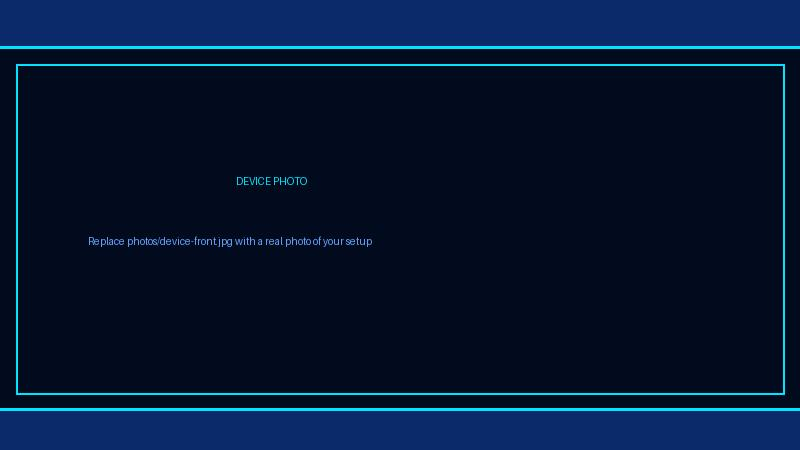
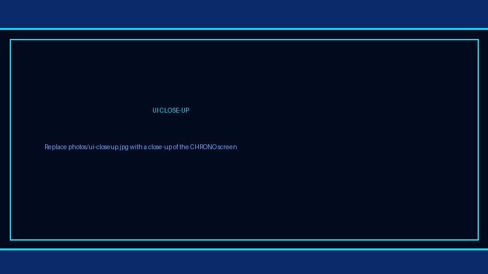
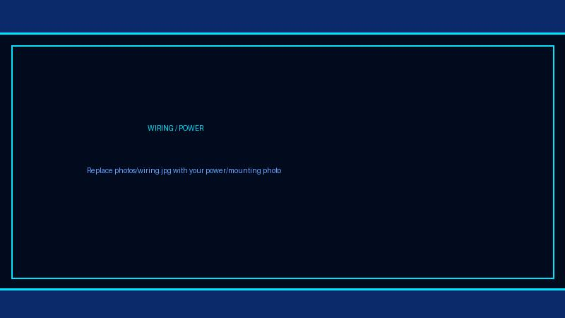

# Digital Clock (CHRONO) — CrowPanel ESP32 HMI 7-inch

A Wi-Fi-connected dual-timezone digital clock for the Elecrow **CrowPanel 7-inch ESP32-S3 HMI** (800 × 480 RGB panel, GT911 touch). The CHRONO dashboard shows Indian Standard Time (IST) and UK local time (with exact British Summer Time transitions), the date, a day-progress bar, and live Wi-Fi/NTP status — with a bright seven-segment display and a configurable accent color.

<!-- PHOTOS: replace the files in photos/ with real photos of your device. Keep the same file names and the README updates automatically. -->



<table>
<tr>
<td></td>
<td></td>
</tr>
</table>

## Features

- Dual timezone clock — IST (UTC+5:30) and UK (full `GMT0BST` DST rules) — in 12-hour format with AM/PM markers
- Real seven-segment digit rendering (no font dependency), with blinking colons
- Day-progress bar with percentage, day name and date
- Live status header: Wi-Fi and NTP indicator LEDs, 12H/24H indicator
- Robust networking: Wi-Fi reconnect with exponential backoff (2 s → 60 s), three fallback NTP servers (`time.google.com`, `pool.ntp.org`, `time.cloudflare.com`), 6-hour re-sync, automatic recovery after outages
- AP configuration portal (`CrowPanel-Config`, password `12345678`) when no credentials are stored — configure from a phone via `http://192.168.4.1`
- Touch controls: brightness ±, accent-color cycler (teal → cyan → amber → magenta), 12H/24H toggle; tap the clock panel for time details
- PWM backlight control

## Hardware and software

- Elecrow CrowPanel ESP32-S3 HMI, 7-inch, 800 × 480 RGB display, GT911 touch
- USB data cable and a **2.4 GHz** Wi-Fi network (the ESP32-S3 cannot see 5 GHz networks)
- Visual Studio Code with the PlatformIO IDE extension
- Pinned dependencies: LovyanGFX 1.1.12, LVGL 8.3.11; vendored libraries in `lib/` (PCA9557 IO expander for V3.0 touch timing, patched TAMC_GT911)

## Configure Wi-Fi

Copy `include/secrets.example.h` to `include/secrets.h`, then set:

```c
const char* WIFI_SSID     = "YourNetwork";
const char* WIFI_PASSWORD = "YourPassword";
```

`secrets.h` is git-ignored — never commit it. Alternatively, leave credentials empty: the display starts the AP configuration portal, and credentials entered there are stored in NVS.

## Build and flash with VS Code (step by step)

If you have never used PlatformIO before, follow this from scratch:

1. **Install Visual Studio Code** — download it from <https://code.visualstudio.com> and install with the default options.
2. **Install the PlatformIO extension** — open VS Code, click the **Extensions** icon in the left sidebar (four squares), search for `PlatformIO IDE`, and click **Install**. Wait until the alien PlatformIO icon appears in the left sidebar (first install can take a few minutes).
3. **Download this project** — click **Code → Download ZIP** on GitHub, or run `git clone https://github.com/papercodeIN/Elecrow.git`, then find this folder on disk.
4. **Open the project** — in VS Code choose **File → Open Folder…** and select *this* `platformio` folder (the one containing `platformio.ini`). Do **not** open the repository root — PlatformIO must see `platformio.ini` in the folder you open.
5. **Add your Wi-Fi credentials** — in the VS Code Explorer, right-click `include` → copy `secrets.example.h`, paste it in the same folder, rename the copy to `secrets.h`, and fill in your SSID and password. (Or skip this and use the AP portal described above.)
6. **Wait for the first build tools to download** — PlatformIO automatically downloads the ESP32 toolchain and the pinned libraries (LovyanGFX, LVGL) on the first build. Watch the bottom status bar; this can take several minutes on the first run.
7. **Connect the display** — plug the CrowPanel into the PC with a USB **data** cable. If no port appears, install the USB-to-serial driver for your board and pick the port (e.g. `COM11`) in the bottom status bar.
8. **Build** — click the **✔ (checkmark)** icon in the bottom PlatformIO toolbar (or the alien icon → *Project Tasks → Build*). The terminal should end with `SUCCESS`.
9. **Upload** — click the **→ (right arrow)** icon in the bottom toolbar (or *Project Tasks → Upload*). When it finishes, the display resets and boots into the clock.
10. **Watch the logs** — click the **plug (socket)** icon in the bottom toolbar to open the Serial Monitor. It must be set to **115200 baud** (this project's `platformio.ini` already sets `monitor_speed = 115200`). You should see the boot banner, Wi-Fi connection, `NTP time valid`, and a per-minute `IST ... | UK ...` line.

The equivalent command-line workflow, if you prefer a terminal:

```bash
pip install platformio
cd platformio
pio run                # build
pio run -t upload      # flash
pio device monitor     # serial logs at 115200
```

> Note: GPIO35–38 are reserved by the octal PSRAM on this board — don't attach anything to them.

## Project layout

- `src/main.ino` — display/touch init, CHRONO network + NTP state machine, interactive features
- `src/ui_Screen1.c`, `src/ui.c` — CHRONO dashboard UI (seven-segment widgets, panels, footer)
- `include/` — UI headers, `lv_conf.h` (LVGL tick via `millis()`, fonts), `touch.h`, `secrets.example.h`
- `lib/PCA9557`, `lib/TAMC_GT911` — vendored libraries (GT911 `reset()` guarded for expander-driven reset)
- `photos/` — device photos used by this README (placeholders — replace with your own)

## Customization

- **Accent colors** — `changeColorTheme()` in `src/main.ino` cycles the clock color; chrome (borders/rules) stays cyan via `ui_apply_accent()` in `src/ui.c`
- **Digit size** — `DIG_W`, `DIG_H`, `SEG_T` in `src/ui_Screen1.c`
- **Palette** — `CHRONO_*` defines at the top of `src/ui_Screen1.c`
- **Timezone** — IST offset is `IST_OFFSET_SECONDS`; UK uses the `GMT0BST,M3.5.0/1,M10.5.0/2` POSIX rule in `UK_TZ_SPEC`
- **NTP servers / retry timing** — `NTP_SERVERS`, `WIFI_BACKOFF_*`, `NTP_*` constants in `src/main.ino`
