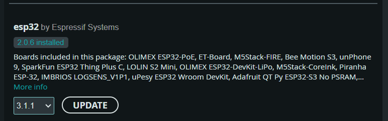

# CrowPanel ESP32 7" HMI Display

Projects and examples for the Elecrow CrowPanel ESP32 7-inch HMI touch display — 800 × 480 RGB panel with capacitive touch, Wi-Fi and Bluetooth.

## Projects

Standalone PlatformIO projects, each with its own build guide:

| Project | Description |
|---|---|
| [Bluetooth Stream Deck](<Project/Bluetooth_Stream_Deck/README.md>) | BLE HID keyboard deck — 4×4 touch tiles send shortcuts and media keys straight to the paired computer |
| [Digital Clock (CHRONO)](<Project/Digital_Clock/README.md>) | Dual-timezone Wi-Fi clock with NTP sync and AP setup portal |
| [Digital Photo Frame](<Project/Digital_Photo_Frame/README.md>) | Image slideshow from SD card or a browser-based web interface |
| [WiFi Stream Deck](<Project/WiFi_Stream_Deck/README.md>) | Touch shortcut deck that triggers actions over the network |
| [Wireless Text Display](<Project/Wireless_Text_Display/README.md>) | Push live text messages to the display from any browser on the network |

## Examples

Arduino IDE sketches accompanying the video tutorials, in `Project/Example`:

| Example | Description |
|---|---|
| `mqtt_dashboard` | LVGL dashboard fed by an MQTT broker |
| `led_control_lvgl` | LED / relay control UI, with a Modbus relay example |
| `sqs_components_demo` | SquareLine Studio components demo |

## Manufacturer resources

- Product page: [CrowPanel ESP32 7" HMI Display](https://www.elecrow.com/esp32-display-7-inch-hmi-display-rgb-tft-lcd-touch-screen-support-lvgl.html)
- Product wiki — datasheets, wiring and Arduino IDE setup: [Elecrow wiki](https://www.elecrow.com/wiki/esp32-display-702727-intelligent-touch-screen-wi-fi26ble-800480-hmi-display.html)
- Official GitHub repository — datasheets, schematics, examples and factory firmware: [Elecrow-RD/CrowPanel-7.0-HMI-ESP32-Display-800x480](https://github.com/Elecrow-RD/CrowPanel-7.0-HMI-ESP32-Display-800x480)
- Arduino libraries bundle: [libraries.zip](https://www.elecrow.com/download/product/CrowPanel/ESP32-HMI/7.0-DIS08070H/Arduino_Tutorial/libraries.zip)
- Hardware is available from [Elecrow](https://www.elecrow.com/) — new customers can use this [referral link for a $5 coupon](https://www.elecrow.com/referral-program/Nzk5MjJqMnQ/)

## Component versions

| Environment | esp32 core | LVGL | Notes |
|---|---|---|---|
| Arduino IDE (official tutorial code) | 2.0.14 / 2.0.15 | 8.3.3 | Versions recommended by the manufacturer's tutorial code; select the board package in the Arduino Boards Manager |
| PlatformIO (projects above) | pinned per project | pinned per project | See each project's `platformio.ini` |

Selecting the esp32 board package version in the Arduino IDE Boards Manager:

## Video walkthroughs

Build and demo videos on the [Fusion Automate YouTube channel](https://www.youtube.com/channel/UCKKhdFV0q8CV5vWUDfiDfTw):

- [CrowPanel ESP32 7" playlist](https://www.youtube.com/playlist?list=PLxrSjjYyzaaImkFRbGMiRHKIos24P5MyG)
- [Getting Started with CrowPanel ESP32 7" — Arduino IDE setup + LVGL demo](https://youtu.be/WoOipX0rxyI)

| Short | Watch |
|---|---|
| Display demo | [Watch](https://youtube.com/shorts/n-mweJUiFVo) |
| Unboxing | [Watch](https://youtube.com/shorts/BTeFulyKxNg) |
| Desk lamp — LVGL + home automation | [Watch](https://youtube.com/shorts/hmtIqroSycU) |
| Collision circles — LVGL demo | [Watch](https://youtube.com/shorts/wUxxCRZnBU4) |
| SquareLine Studio example | [Watch](https://youtube.com/shorts/zOHKd8TkUtw) |
| Wireless text display | [Watch](https://youtube.com/shorts/kWhKw6H5ELc) |
| Dual-time digital clock | [Watch](https://youtube.com/shorts/ustcSW7BS_Y) |

## Support

If these projects help you, consider supporting the channel:

&nbsp;&nbsp;

## Contact

| Method | Details |
|---|---|
| Call / WhatsApp | [+91-9974477759](https://wa.me/919974477759) |
| Telegram | [@fusionautomate](https://t.me/fusionautomate) |
| Email | [eng.innovativ@gmail.com](mailto:eng.innovativ@gmail.com) |
